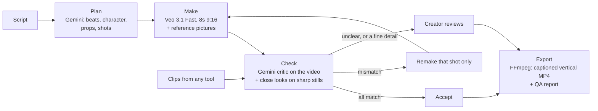

# DramaGraph

A continuity supervisor for AI-made microdramas, built for the Google AI Builder Cup 2026
(Media, Content & Digital Experiences track).

AI video models forget what happened in the previous shot: clothes change colour, a prop
is open before anyone opens it, a round box turns square. DramaGraph turns a short script
into a shot plan, makes each shot with Veo, has Gemini check every clip against the story,
and remakes only the shots that fail. It can also check clips made with any other tool.

- **Live app:** https://dramagraph-363915816247.asia-southeast1.run.app
- **Demo video:** [demo video link]
- **Deck:** `DramaGraph-deck.pdf` in the submission

## Try it (for judges)

1. **Saved episodes** (sidebar): open an episode to see each shot, its problems, the
   close-ups the critic compared, every version made, and the final video.
2. **Check my own clips**: upload up to four short MP4 clips (30 MB each) from any tool, describe the
   person and one prop, and get the same checks. No video is generated.
3. **Make an episode**: paste a script, review the plan (character, props, rules, shots),
   then make the shots. Making video needs the passcode given in the submission form; a
   hard cap on Veo seconds applies.

## How the critic decides

Three layers, from most to least fixed:

1. **Fixed checks** for every clip: wardrobe, prop appearance, prop state, scene, and a
   comparison with the previous shot. A mismatch regenerates the shot. Looks are judged
   point by point (shape, parts, size compared with the person, finish, colour; face,
   clothes) on the video and again on sharp, enlarged still frames. When the first shot
   passes, a still of the person and each prop becomes the **approved look**: later shots
   and repairs are sent it as a reference picture and checked against it. A picture the
   creator adds always takes its place.
2. **Open observations**: the critic also watches like a script supervisor and reports
   anything else a viewer would find odd. These are advisory and never spend video budget.
3. **Rules learned from the creator**: when a person spots a problem the critic missed, or
   promotes an observation, their note becomes a rule the critic enforces from then on.
   Rules stay in their own episode. A rule that applies to every shot can be kept on
   purpose (☆ Keep); kept rules are offered to new episodes but never added without a click.
   Rules about small details (a clock time, writing, a number) get a **close look**: sharp
   still frames are taken from the clip, Gemini finds the object, the app enlarges it, and
   Gemini reads it step by step. An unsure reading is "unclear", never a guess, and a wrong
   reading goes to the creator for review instead of an automatic remake, because video
   models often cannot draw such details exactly.

## Architecture



Everything runs in one container on **Cloud Run**. Episode records, clips, pictures and the
Veo spending ledger live in **Cloud Storage**; the API key and the video passcode live in
**Secret Manager**. The model never decides whether to spend money: Gemini reports
match, mismatch or unclear for each check, and the code applies a fixed rule.

### Code map

| Path | What it does |
|---|---|
| `app.py`, `pages_ui/` | Streamlit screens: make an episode (Script, Plan, Shots, Export), check my own clips, saved episodes |
| `dramagraph/parser.py`, `canon.py`, `planner.py` | Script to beats, character and props, shot plan (Gemini, structured output) |
| `dramagraph/prompt_compiler.py`, `generator.py` | Veo prompts and generation, reference pictures, retries |
| `dramagraph/critic.py` | The critic: fixed checks, observations, creator rules, the decision |
| `dramagraph/close_look.py`, `looks.py` | Sharp stills, find and enlarge, point-by-point looks, approved look |
| `dramagraph/learning.py` | Turns a creator's note into a rule |
| `dramagraph/pipeline.py`, `repair.py` | Make, check, repair, re-check, keep or drop a shot |
| `dramagraph/ration.py` | Hard cap on Veo seconds, with refunds for refused requests |
| `dramagraph/assembler.py`, `qa_report.py` | Final video and QA report |
| `prompts/` | Every prompt sent to Gemini, as plain text |
| `tests/` | 106 tests that run the whole pipeline with a stand-in for Gemini and Veo |

## Results so far

From the QA report of the recorded demo run (15 October 2026, 2 shots): the critic caught 3
errors, a planted red top and two of Veo's own mistakes (a three-tier, matte lunch box, and
later a rectangular box). Both shots with an error were fixed by automatic repair. The
creator caught two misses, a matte finish and an oversized box; both became rules and led
to the point-by-point and close-look checks, which are not yet measured on real clips. The
run used 6 clips, 48 seconds of Veo video. One run is a demonstration, not a benchmark; a
larger labelled test set is next.

## Models

| Job | Model | Setting |
|---|---|---|
| Critic (watches each clip) | Gemini `gemini-3.8-flash` | `VIDEO_UNDERSTANDING_MODEL` |
| Planning (beats, details, shots, rules) | same as the critic unless set | `TEXT_MODEL` |
| Video generation | Veo `veo-3.1-fast-generate-preview`, 8-second 9:16 clips at 720p | `VEO_MODEL` |

Other settings are listed in `.env.example`. `CRITIC_FPS` sets how many frames a second the
critic looks at (Gemini's default is about 1).

## Run locally

```bash
pip install -r requirements.txt
cp .env.example .env    # then fill in your own values
pytest                  # tests need no API key; Gemini and Veo are replaced by a fake
streamlit run app.py
```

Without `GCS_BUCKET`, episodes are saved in `local_data/`. Without `GEN_PASSCODE`, video
generation stays switched off; check-only mode still works.

## Deploy to Cloud Run

The API key and the passcode live in Secret Manager, never in the repository.

```bash
gcloud secrets create gemini-key --data-file=-      # paste the key, then Ctrl+D
gcloud secrets create gen-passcode --data-file=-    # a made-up passcode, not the key
gcloud storage buckets create gs://YOUR_BUCKET --location=asia-southeast1

gcloud run deploy dramagraph --source . --region asia-southeast1 \
  --set-secrets=GEMINI_API_KEY=gemini-key:latest,GEN_PASSCODE=gen-passcode:latest \
  --set-env-vars=GCS_BUCKET=YOUR_BUCKET,VIDEO_UNDERSTANDING_MODEL=gemini-3.8-flash,VEO_MODEL=veo-3.1-fast-generate-preview
```

The Cloud Run service account needs *Secret Manager Secret Accessor* and access to the
bucket. Later code changes only need `gcloud run deploy dramagraph --source . --region asia-southeast1`;
settings can be changed without a rebuild with `gcloud run services update dramagraph
--region asia-southeast1 --update-env-vars=NAME=value`.

## Measure the critic

```bash
python -m eval.run_eval eval/labels.csv path/to/clips 3
```

`labels.csv` holds one hand-labelled row per clip (see `eval/run_eval.py` for the columns).
The last number is how many times each clip is checked, to measure consistency.

## Future scope

- A larger evaluation set (25–30 clips, including subtle wardrobe changes and clips from
  other video tools), scored by the second each error appears, with "caught", "sent to
  review" and "missed" reported separately.
- Product continuity for ads: the same product, logo and packaging across every clip.
- Rule libraries per creator or team, once the app has sign-in.

## Known limits

- Veo cannot reliably draw exact details such as a clock time or a line of writing; rules
  about them are checked on close-ups and sent to the creator rather than remade.
- One on-screen character; a second person only as hands or a voice.
- English scripts; 8-second shots.

## Google technology used

Gemini (planning, video understanding, close looks), Veo 3.1 (video generation), Cloud Run,
Cloud Storage, Secret Manager.

Never commit `.env` or any API key.
